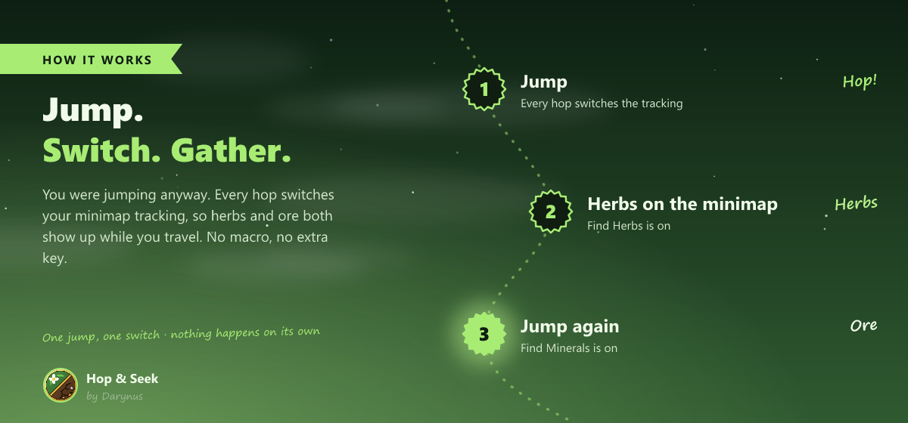
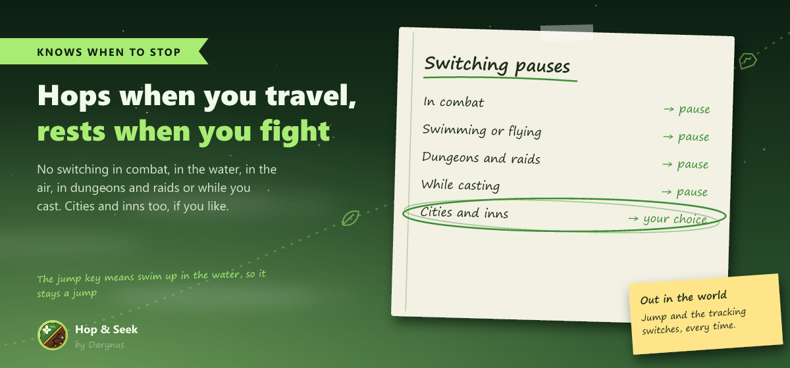
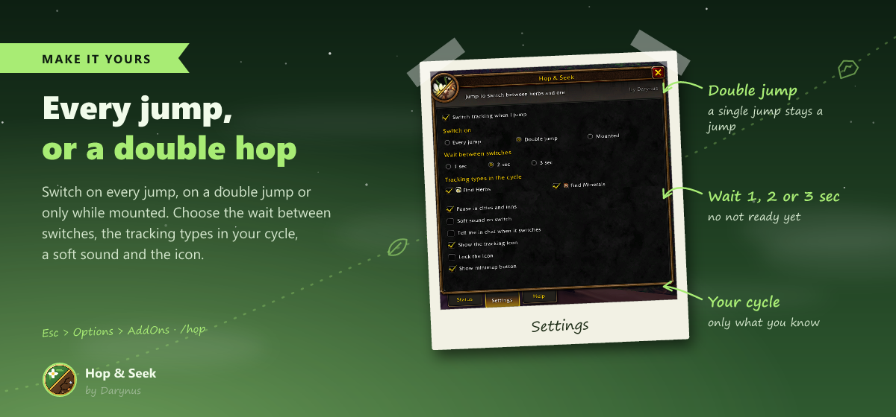

<h1 align="center">Hop & Seek</h1>

<b>Jump to switch your minimap tracking between Find Herbs and Find Minerals.</b> 
One switch per jump, nothing happens on its own.

<a href="https://www.curseforge.com/wow/addons/hop-seek-forever">CurseForge</a> ·
<a href="CHANGELOG.md">Changelog</a> ·
<a href="https://github.com/Darynus/HopAndSeek/issues">Report a bug</a>

> **Made for WoW Forever** (client 1.60.1). Have fun hopping, and tell me how it hops for you!

You love hopping through Azeroth and grabbing every herb and every ore vein on the way? Then Hop & Seek is your new best friend. Every gatherer knows the struggle: one tracking at a time. Most of us glued a cast sequence macro to some key and pressed it until the finger hurt. Hop & Seek throws that macro out of the window: just jump. Every hop switches your minimap tracking. Be honest, you were jumping anyway.

## How it works

- **Jump to switch:** one press of the jump key, one switch. Nothing happens on its own: no timer, no macro, no spell button.
- **No "not ready yet" spam:** switching has a short cooldown in the game. Hop & Seek waits 1, 2 or 3 seconds between switches and never tries while the cooldown runs.
- **Pick your hop:** every jump, double jump (tap jump twice quickly) or only while mounted or in travel form.
- **Your cycle:** Find Herbs and Find Minerals by default. Dwarves can add Find Treasure, hunters their tracks, druids, paladins and warlocks their senses. Hop & Seek only uses what your character knows.
- **Only one gathering profession?** Then Hop & Seek keeps that tracking on. The game switches it off after logging in or dying, your next jump turns it back on, and a line in your chat reminds you.

## Knows when to stop

No switching in combat, while swimming (the jump key means swim up there), while flying, in dungeons and raids or while you cast. Cities and inns too, if you like.

## Checks itself

Hop & Seek checks once whether switching works in your game and how long the cooldown is, and shows it in the Status tab.

## Install

- **CurseForge app**: search for *Hop & Seek* under World of Warcraft, Forever.
- **By hand**: download the zip from CurseForge and put the `HopAndSeek` folder into `World of Warcraft\_classic_beta_\Interface\AddOns`. Restart the game.

## Commands

| Command | What it does |
|---|---|
| `/hop` | open or close the window |
| `/hop switch` | switch once |
| `/hop on` / `/hop off` | switch Hop & Seek on or off |
| `/hop jump` | switch on every jump |
| `/hop double` | switch on a double jump |
| `/hop mounted` | switch on every jump while mounted |
| `/hop debug` | show your tracking types and the self-check |
| `/hop help` | list all commands |

## Safe and fair

- **One jump, at most one switch.** No timers, nothing happens without your key press.
- **Only the minimap tracking.** No spells, no macros, no targeting.
- **Every game language:** tracking types are recognized by their spell IDs, never by names.
- Free, no ads, MIT license.

## Feedback

Made by a gamer, for gamers. Hop & Seek is free and always will be. Ideas and bug reports are welcome on [GitHub](https://github.com/Darynus/HopAndSeek/issues) or in the CurseForge comments. Happy hopping!
