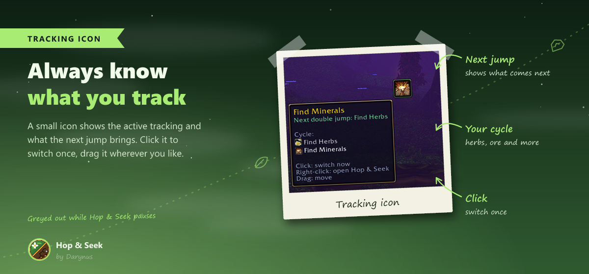
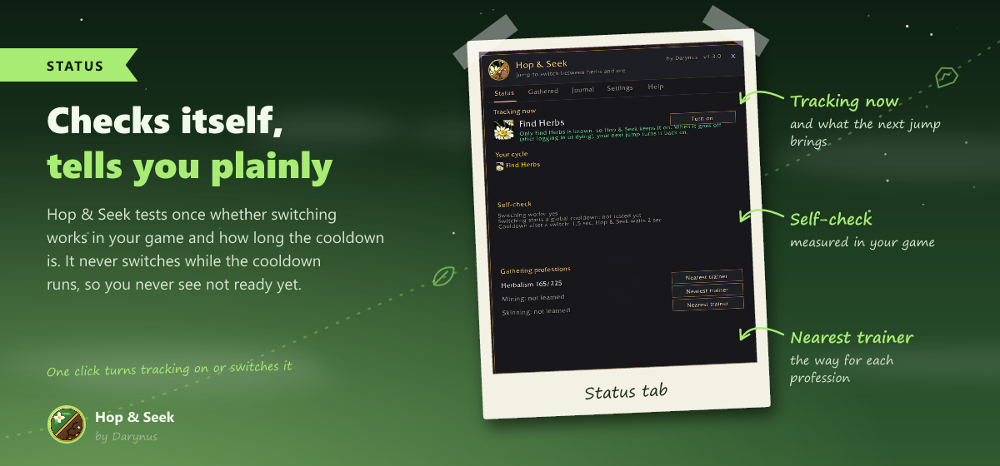

<h1 align="center">Hop & Seek</h1>

<b>Jump to switch your minimap tracking between Find Herbs and Find Minerals.</b> 
One switch per jump, nothing happens on its own.

<a href="https://www.curseforge.com/wow/addons/hop-seek-forever">CurseForge</a> ·
<a href="CHANGELOG.md">Changelog</a> ·
<a href="https://github.com/Darynus/HopAndSeek/issues">Report a bug</a>

> **Made for WoW Forever** (client 1.60.1). Have fun hopping, and tell me how it hops for you!

You love hopping through Azeroth and grabbing every herb and every ore vein on the way? Then Hop & Seek is your new best friend. Every gatherer knows the struggle: one tracking at a time. Most of us glued a cast sequence macro to some key and pressed it until the finger hurt. Hop & Seek throws that macro out of the window: just jump. Every hop switches your minimap tracking. Be honest, you were jumping anyway.

## New in 1.3

- **Radar**: your minimap as a large radar around your character, like a pilot's screen, with north, east, south and west. Only the game's own herbs and ore as dots, no land, right where you look. Turn it on with the radar button, `/hop radar` or your own key.
- **Your spots on the radar and the minimap**: a bracket at every spot you know, with the icon of what grows there, yards and the time to get there. A dot in the bracket: the node is up. An empty bracket: someone was faster.
- **Skill colors** like in the game: orange, yellow and green still give skill points, gray no more, red is above your skill. With the thresholds of WoW Forever.
- **Names**: point at a bracket in the radar for its name, hold Alt for any other dot. New spots are remembered as you point at them.
- **Arrow with Alt + click**: click a dot in the radar, and a golden arrow leads you straight there.
- **New look**: a dark window with a fine gold edge, tabs on top and large numbers.
- Next spot and the route are gone: the radar shows you the real nodes.

## How it works

- **Jump to switch:** one press of the jump key, one switch. Nothing happens on its own: no timer, no macro, no spell button.
- **No "not ready yet" spam:** switching has a short cooldown in the game. Hop & Seek waits 1, 2 or 3 seconds between switches and never tries while the cooldown runs.
- **Pick your hop:** every jump, double jump (tap jump twice quickly) or only while mounted or in travel form.
- **Your cycle:** Find Herbs and Find Minerals by default. Dwarves can add Find Treasure, hunters their tracks, druids, paladins and warlocks their senses. Hop & Seek only uses what your character knows.
- **Only one gathering profession?** Then Hop & Seek keeps that tracking on. The game switches it off after logging in or dying, your next jump turns it back on, and a line in your chat reminds you.

## Count what you gather

- **Gathering counter**: herbs, ore, stone and gems you loot from nodes, and the leather and hides you skin, per session and all time, with the number of nodes and an amount per hour. The new Gathered tab lists every item.
- **Gold per hour**: a small gathering window shows your gold per hour, how much you gathered and your best finds while you are out gathering.
- **What it is worth**: with Auctionator installed, Hop & Seek shows the value of your haul, in total and per hour. Midas works too, pick it in the Gathered tab.
- **Time to train**: a reminder when Herbalism, Mining or Skinning needs a trainer, and the level you need for the next rank. Click the hint in the gathering window, use the Status tab or type `/hop trainer`, and the game's marker shows the way to the nearest trainer of your faction.
- The count of this session sits under the tracking icon, the details are in its tooltip. A new session starts after 30 minutes without gathering, or with Start over, and a line in your chat sums up the last one.

## Find your next node

- **Radar**: your minimap moves to the middle of your screen as a large, see-through radar around your character, with north, east, south and west at its edge. You see the game's own herb and ore dots where you look instead of up in the corner. It turns with you, clicks go through it into the world, and it fades during a fight. Turn it on with the radar button in the gathering window or the Gathered tab, `/hop radar` or your own key, which you set right in the Gathered tab. Your minimap goes back exactly as it was.
- **Brackets at your spots**: Hop & Seek remembers every herb and ore vein you gather. In the radar and on your minimap, each spot gets a bracket with the icon of what usually grows there, the yards and the time to get there at your current speed. The middle stays free: a dot in the bracket means the node is up, an empty bracket means it was gathered or has not grown back yet.
- **Skill colors**: the brackets are colored like the game does it: orange, yellow and green still give skill points, gray no more, red is above your skill.
- **Names and new spots**: point at a bracket in the radar for its name. Hold Alt over any other dot to see what it is, and Hop & Seek remembers the spot. On your minimap, pointing at a new dot is enough.
- **Arrow with Alt + click**: hold Alt and click a dot in the radar, and a golden arrow with a dotted line leads you straight there. It goes away when you arrive. The game does not tell add-ons where its dots are, so you pick the node, and the arrow never sends you to an empty spot on its own.
- **Light pillar**: a beam of light over the herb, ore vein or creature to skin right in front of you, in three looks: a soft Glow, rising Fireflies or a clear Beam. Switch it on in Settings.

## Make gathering a game

The Journal tab turns every trip into a little adventure:

- **Seeker points and ranks**: every node earns points, new kinds and uncommon finds earn more. Climb from Wanderer to Legend of the Wilds.
- **Daily goal and streak**: pick 10, 25, 50 or 100 nodes a day and keep your streak going.
- **Records**: gold per hour, nodes in one session, your best haul and your longest session. Beat them and Hop & Seek lets you know.
- **23 badges**, from First Find to Lotus Luck.
- **Field guide**: every herb, ore, stone and gem you can gather in Forever, including the new ones like Rosecap, Bauxite and Torbernite. Fill it up!
- **Compare with friends**: share your journal with your group with one click and see their ranks and records next to yours.
- A small pop-up with a game sound tells you when you earn something. Prefer it quiet? Switch pop-ups off and get a chat line instead.

## Knows when to stop

No switching in combat, while swimming (the jump key means swim up there), while flying, in dungeons and raids or while you cast. Cities and inns too, if you like.

## Checks itself

Hop & Seek checks once whether switching works in your game and how long the cooldown is, and shows it in the Status tab.

## Install

- **CurseForge app**: search for *Hop & Seek* under World of Warcraft, Forever.
- **By hand**: download the zip from CurseForge and put the `HopAndSeek` folder into `World of Warcraft\_forever_\Interface\AddOns`. Restart the game.

## Commands

| Command | What it does |
|---|---|
| `/hop` | open or close the window |
| `/hop switch` | switch once |
| `/hop on` / `/hop off` | switch Hop & Seek on or off |
| `/hop jump` | switch on every jump |
| `/hop double` | switch on a double jump |
| `/hop mounted` | switch on every jump while mounted |
| `/hop reset` | start a new gathering session |
| `/hop journal` | open the journal: rank, daily goal, records, badges, field guide |
| `/hop share` | share your journal with your group |
| `/hop pillar` | switch the light pillar on or off |
| `/hop pillar glow` | pick its look: `glow`, `fireflies` or `beam` |
| `/hop trainer` | show the way to the nearest trainer, also `/hop trainer herbalism`, `mining` or `skinning` |
| `/hop radar` | show your minimap as a large radar around your character, or put it back |
| `/hop radar terrain` | show or hide the land in the radar |
| `/hop radar test` | test a see-through mask, in case the land stays in the radar |
| `/hop news` | show what is new |
| `/hop debug` | show your tracking types and the self-check |
| `/hop help` | list all commands |

## Safe and fair

- **One jump, at most one switch.** No timers, nothing happens without your key press.
- **Only what you ask for.** Hop & Seek switches your minimap tracking. The light pillar turns on the game's interact highlight while it is on and puts your settings back when you switch it off. The radar borrows your minimap while it is on and puts it back exactly as it was, also when you log out. The trainer finder sets the game's map pin only when you click. No spells, no macros, and the gathering counter only reads your loot window.
- **Every game language:** tracking types are recognized by their spell IDs, never by names.
- Free, no ads, MIT license.

## Feedback

Made by a gamer, for gamers. Hop & Seek is free and always will be. Ideas and bug reports are welcome on [GitHub](https://github.com/Darynus/HopAndSeek/issues) or in the CurseForge comments. Happy hopping!
